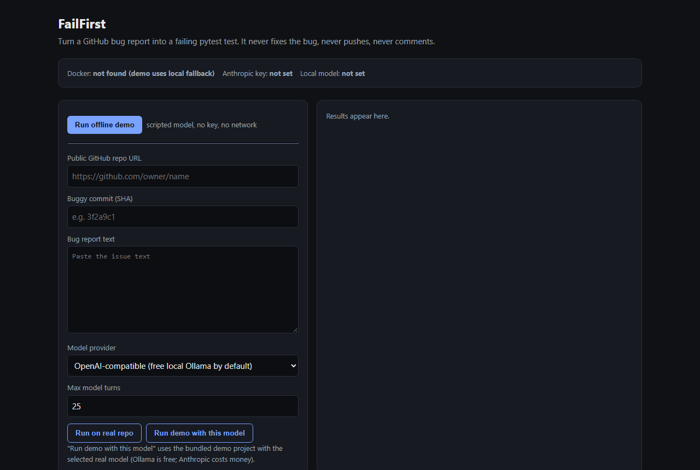
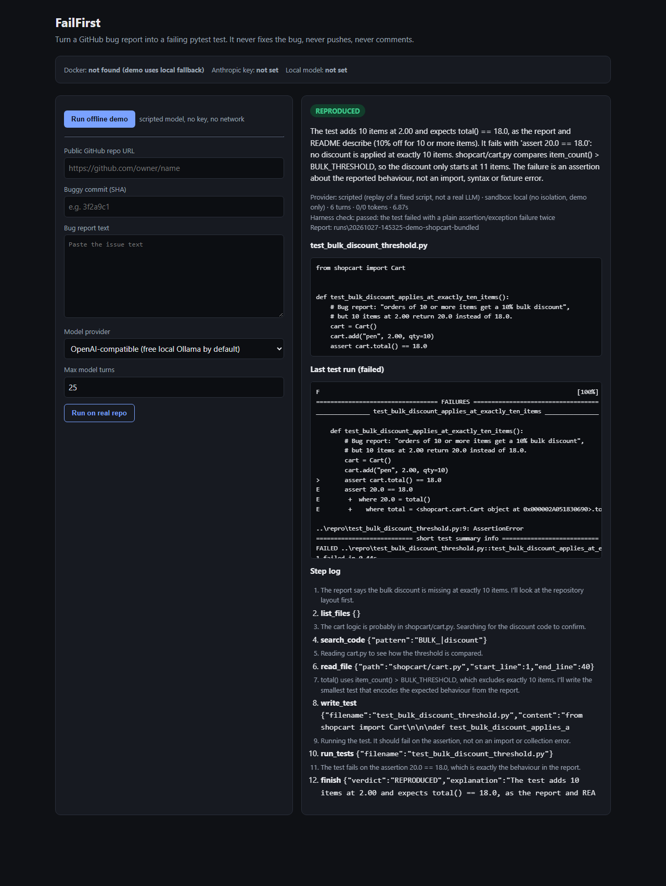
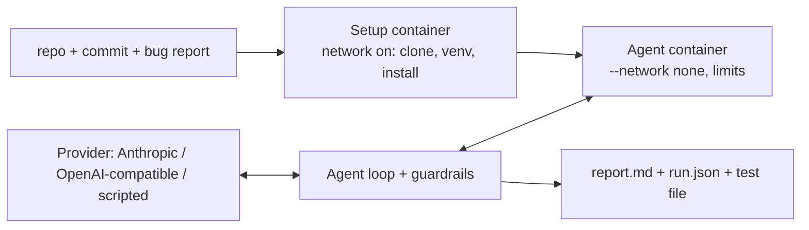

# FailFirst

An AI agent that turns a GitHub bug report into a **failing pytest test**.

You give it a public GitHub repo, the buggy commit and the bug report text. It explores the code in a sandbox, writes the smallest test that should capture the bug, runs it, and returns a report with one verdict:

- **REPRODUCED**: the test fails, for the reason in the report
- **NOT_REPRODUCED**: no valid failing test (or a budget ran out)
- **NEEDS_INFO**: the report is too vague, or the repo could not be set up

Each report includes the test file, the reasoning and a step log. FailFirst never fixes the bug, never pushes anything and never comments on GitHub.

> Evaluation tooling is included but results have not been measured yet.

**Project page:** https://omkar210404.github.io/Fail-First/ (it replays real recorded runs; GitHub Pages cannot run the agent itself).

## Screenshots

The local web page (`failfirst ui`), before a run and after the offline demo. The demo uses a scripted model, not a real LLM.





## How it works

1. **You give it three things:** a public GitHub repo URL, the commit that has the bug, and the bug report text.
2. **Setup:** in a throwaway Docker container (network on), it clones the repo at that commit and installs it with its test tools. If this fails, the verdict is NEEDS_INFO with the reason.
3. **Agent:** a second container starts with **no network**. The model reads the bug report and explores the code with read-only tools (`list_files`, `read_file`, `search_code`).
4. **Test:** the model writes the smallest pytest test that expects the correct behaviour (`write_test`) and runs it (`run_tests`). If the test breaks for the wrong reason (typo, import error), the model fixes it and runs it again.
5. **Verdict:** the model calls `finish`. If it says REPRODUCED, FailFirst checks the claim itself: the test must fail twice in a row with a real test failure, not an import, syntax, collection or fixture error.
6. **Report:** you get `report.md`, `run.json` and the test file in `runs/<time>-<repo>/`, or on the web page.

## Architecture

A **provider** layer hides the model behind one `complete()` call: Anthropic (official SDK, tool use), any OpenAI-compatible endpoint (including free local models through Ollama), or a **scripted** replay used by the demo. The **agent loop** sends the bug report (marked as untrusted data) and six tools to the model: `list_files`, `read_file`, `search_code`, `write_test`, `run_tests` and `finish`. It runs each tool call in the **sandbox** and enforces budgets (steps, tokens, optional cost cap, per-command timeouts, output trimming). The sandbox works in two phases. First, a throwaway Docker container with network access clones the repo at the commit and installs it. Then a second container with `--network none` runs the agent's commands, with CPU, memory and process limits, a read-only repo and one writable repro folder. When the model claims REPRODUCED, the harness checks that claim before accepting it: the test must fail twice in a row with a plain test failure, not an import, syntax, collection or fixture error. Every run writes `report.md`, `run.json` and the test file into `runs/`.



## What you need

| For | You need | Cost |
|---|---|---|
| The offline demo | Python 3.11+ | free |
| The demo with a real model | + Ollama and a local model (about 5 GB disk; a GPU helps but is not required), **or** your own Anthropic API key | Ollama is free; Anthropic is **paid per run** |
| Real GitHub repositories | + Docker (Docker Desktop is free for personal use) | free |

## Setup, step by step

Commands are for Windows PowerShell. macOS/Linux differences are noted.

### Step 1: Python

Install Python 3.11 or newer from [python.org](https://www.python.org/downloads/), or run `winget install Python.Python.3.11`. Check it with `python --version`.

### Step 2: FailFirst and the offline demo (no key, no network)

```bash
git clone https://github.com/Omkar210404/Fail-First
cd Fail-First
python -m venv .venv
.venv\Scripts\activate          # macOS/Linux: source .venv/bin/activate
pip install -e .
failfirst demo
```

You should see the agent's steps and `REPRODUCED` at the end. For the web page, run `failfirst ui` and open http://127.0.0.1:8765.

### Step 3: A free local model with Ollama (optional)

1. Install Ollama from [ollama.com/download](https://ollama.com/download), or run `winget install Ollama.Ollama`. It runs in the background (look for the icon near the clock).
2. Download the model (about 4.7 GB): `ollama pull qwen2.5-coder:7b`
3. Create a version with a bigger context window. Ollama's default of 4,096 tokens is too small, because the model forgets the start of the run. The [Modelfile](Modelfile) for this is in the repo: `ollama create qwen2.5-coder-16k -f Modelfile`
4. Create your settings file: `copy .env.example .env` (macOS/Linux: `cp .env.example .env`). It already points to `qwen2.5-coder-16k`.
5. Try it: `failfirst demo --provider openai-compatible`, or use **Run demo with this model** on the web page.

**Instead of Ollama, you can use Anthropic (paid).** Put `ANTHROPIC_API_KEY=...` in `.env` and use `--provider anthropic`. Every run costs money. The model defaults to `claude-opus-5-5`; change it with `ANTHROPIC_MODEL`. Requests use adaptive thinking, `ANTHROPIC_EFFORT=high` and the server-side refusal fallback (`ANTHROPIC_FALLBACKS=0` turns that off).

### Step 4: Docker, for real repositories (optional)

Real repositories only run inside Docker, so their code never runs directly on your computer.

- **Windows:**
  1. Open PowerShell **as administrator** and run `wsl --install`.
  2. Restart the PC.
  3. Install Docker Desktop from [docker.com](https://www.docker.com/products/docker-desktop/), or run `winget install Docker.DockerDesktop`.
  4. Open Docker Desktop once, accept its terms, and wait until it says the engine is running.
- **macOS:** install Docker Desktop and open it.
- **Linux:** install Docker Engine and make sure your user can run `docker`.

Check it with `docker info`. After that, `failfirst demo` also uses the Docker sandbox automatically. The first time, it downloads `python:3.11-slim` and builds a small image, which needs the network once.

### Step 5: Run on a real bug

1. Save the bug report text to a file, for example `issue.md`.
2. Run:

```bash
failfirst run --repo https://github.com/OWNER/REPO --commit <buggy-sha> --issue-file issue.md --provider openai-compatible
```

Or use **Run on real repo** on the web page. The run's folder in `runs/` has the report.

Options: `--max-steps` (default 25), `--max-tokens` (default 400000 input+output), `--command-timeout` (default 60 s) and `--max-cost-usd`. The cost cap only works after you set `FAILFIRST_PRICE_INPUT_PER_MTOK` and `FAILFIRST_PRICE_OUTPUT_PER_MTOK` to your model's current prices. When any budget is reached, the run stops with NOT_REPRODUCED and gives the reason.

## About the demo

**Demo mode uses a SCRIPTED model, not a real LLM.** [demo/script.json](demo/script.json) replays the tool calls a real agent would plausibly make. Everything else is real: the sandbox, tools, test run, harness check and report. The bundled project [demo/shopcart](demo/shopcart) has a seeded off-by-one bug: `total()` uses `> 10` where the README promises a discount for "10 or more" items. The bug report is [demo/issue.md](demo/issue.md).

If Docker is running, the demo uses the Docker sandbox. The first time, Docker downloads `python:3.11-slim` and builds a small image, so that one step needs the network. Without Docker, the demo falls back to a **local subprocess mode with no isolation**, prints a warning, and refuses to run any project except the bundled demo. Use `failfirst demo --no-docker` to force the fallback.

To try a **real model** on the same demo project, see [Step 3](#step-3-a-free-local-model-with-ollama-optional).

Output from a real run of the scripted demo on Windows without Docker (lines shortened):

```text
WARNING: Docker is not available, so the demo runs in LOCAL MODE with NO ISOLATION.
NOTE: demo mode uses a SCRIPTED model that replays fixed tool calls. It is not a real LLM.
[turn 3] read_file {"path": "shopcart/cart.py", ...} ->     1| """Cart totals with a bulk discount."""
[turn 4] write_test {"filename": "test_bulk_discount_threshold.py", ...} -> wrote test_bulk_discount_threshold.py
[turn 5] run_tests {"filename": "test_bulk_discount_threshold.py"} -> [harness: exit code 1, classified as failed]
[turn 6] finish {"verdict": "REPRODUCED", ...} -> finished
verdict: REPRODUCED  report: runs\20261027-123635-demo-shopcart-bundled
```

### Local web page

```bash
failfirst ui        # then open http://127.0.0.1:8765  (or /#demo to start the demo right away)
```

It has a **Run offline demo** button and a form for real runs: repo URL, commit, bug report and provider. It shows the verdict, the test, the last test output and the step log. It listens on 127.0.0.1 only and rejects requests from other sites.

## Safety

- Real repositories only run inside Docker. Without Docker, `failfirst run` refuses to start.
- The agent phase has **no network** (`--network none`), 1 CPU, 1 GB memory and 256 processes. The root filesystem and the repo are read-only, all capabilities are dropped, and every command is killed after its timeout.
- The agent can write only test files named `test_*.py`, and only into the separate repro folder. It never touches the host.
- Setup (clone and `pip install`) runs the repo's build code with network access, inside a throwaway container.
- The bug report, repo files and test output are treated as untrusted data, never as instructions. A REPRODUCED claim is checked by the harness, not just trusted.
- Keys come only from environment variables or `.env`. They are never logged, and child processes in local demo mode get no variables whose names look like secrets.
- FailFirst never pushes, opens PRs or comments anywhere.

## Evaluation (built, not run)

> Evaluation tooling is included but results have not been measured yet.

[scripts/eval.py](scripts/eval.py) runs the agent on the cases in [eval/cases.json](eval/cases.json). A case counts as **truly REPRODUCED** only if the generated test **fails on the buggy commit** and **passes on the fix commit**. Any other REPRODUCED verdict is recorded as a **false claim**. Results go to `eval/results/` (gitignored).

**To add a case:** pick a closed bug issue in a small, pure-Python repo with a clear open-source licence, where a merged fix PR adds a test. Set `buggy_commit` to the parent of the fix and `fix_commit` to the fix. Paste the issue text (as written before the fix), fill in `licence`, and set `"enabled": true`. Then check the file with `python scripts/eval.py --check`.

```bash
python scripts/eval.py --check                         # validate only
python scripts/eval.py --provider openai-compatible    # free with Ollama
python scripts/eval.py --provider anthropic            # costs money for every case
```

**Paid APIs cost money.** Run one case first (`--only <id>`) and use `--max-cost-usd`.

## Limitations

- **Not verified with Docker yet.** It was built on a machine without Docker, so only the local demo path has been run end to end. The Docker sandbox code (image build, two-phase setup, `--network none` exec) has not been run.
- **Real-model testing so far is a small smoke check, not an evaluation.** The OpenAI-compatible provider was run with a free local model (`qwen2.5-coder:7b` through Ollama with a 16k context, on a laptop RTX 3050) on the bundled demo only. There were 7 runs after fixing the problems that earlier runs exposed. The reminder message for a model that stops calling tools was improved before the last 3. Results: 3 REPRODUCED, each with the harness check passed. 3 NOT_REPRODUCED: the model asserted the buggy value, or stopped calling tools. 1 NEEDS_INFO: the model wrongly said the report had no expected value. A 7B local model is unreliable at this task. Each run took about 15 seconds to 2 minutes. The Anthropic provider has only been tested against a local stub that imitates the API, because no paid API was used.
- Setup is basic: `pip install -e .` (with common test extras) plus `requirements*.txt`. Projects that need system libraries, services or other build tools will end in NEEDS_INFO.
- The test runs from a separate folder, so the repo's `conftest.py` fixtures and pytest settings are not applied.
- The harness can rule out import, syntax, collection and fixture failures. Whether the failure matches the report's reason is still the model's judgement. A bug that really is an ImportError would be rejected.
- Some local models write tool calls as JSON text instead of real tool calls. FailFirst accepts those only when the text is a valid call to one of its six tools.
- Only Python projects with pytest. Small local models make mistakes, for example asserting the buggy value or naming files wrongly. FailFirst then stops with NOT_REPRODUCED instead of guessing. A run also stops after 3 model turns in a row with no tool call.

## Project layout

```text
failfirst/   cli.py, agent.py (loop, tools, guardrails, pipelines), providers.py, sandbox.py, report.py, ui.py
demo/        shopcart/ (seeded bug), issue.md, script.json (scripted provider)
eval/        cases.json (template)
scripts/     eval.py
Modelfile    Ollama model with a 16k context window
```

## License

MIT
